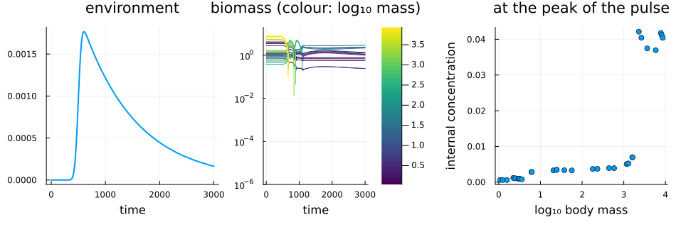
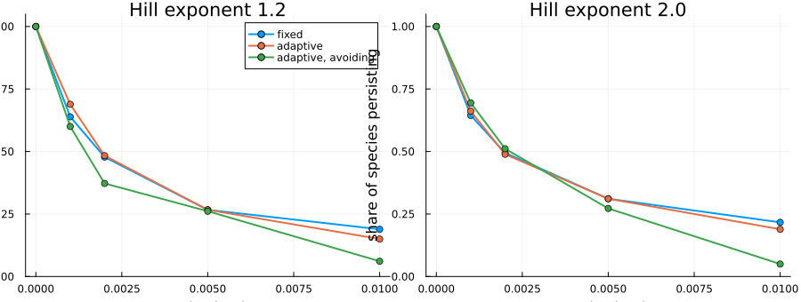
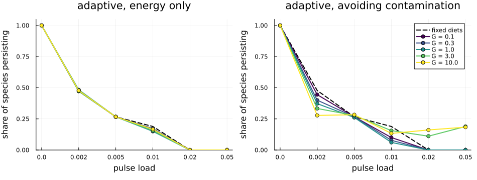

# Adaptive foraging and a pollutant pulse
Simon Frost

- [Overview](#overview)
- [One community and one pulse](#one-community-and-one-pulse)
- [Persistence against the size of the
  pulse](#persistence-against-the-size-of-the-pulse)
- [Reading the results](#reading-the-results)
- [How fast should consumers adapt?](#how-fast-should-consumers-adapt)
- [Summary](#summary)

## Overview

Does adaptive foraging help a food web withstand a toxic pollutant? This
vignette combines:

- an allometric trophic network (ATN);
- a pollutant that plants take up from the environment, consumers
  acquire with their prey, and that adds mortality in proportion to its
  internal concentration;
- adaptive foraging, in which consumers shift effort among their prey by
  replicator dynamics.

Communities are assembled to a steady state, hit with a pulse of
pollutant, and scored by the share of species that persist. Three
foraging strategies are compared:

- **fixed diets**: effort split equally among prey;
- **adaptive**: effort follows the energy gained per unit effort;
- **adaptive, avoiding contamination**: the value of a prey is its
  energy gain minus the expected toxic cost of the pollutant it carries.

The mechanisms follow the general literature (replicator foraging:
Kondoh 2003, Valdovinos et al. 2010; toxicokinetics: in the spirit of
Garay-Narváez et al. 2013). The parameter values are illustrative, not
fitted to any chemical or system. See the docstrings of `ExtendedATN`,
`Pollutant` and `allometric_pollutant`.

``` julia
using FoodWebDynamics
using Random, Statistics, Printf
using Plots

function draw_web(rng; S = 30, nbasal = 8)               # allometric web where every consumer eats
    while true
        mass = sort(10 .^ (4 .* rand(rng, S)))
        web, _ = lmatrix_web(mass; nbasal = nbasal)
        all(c -> any(web.A[c, :]), (nbasal + 1):S) && return web, mass
    end
end
nothing
```

## One community and one pulse

A scaled ATN on a 30-species allometric web is integrated to a steady
state, and then receives a pulse of pollutant centred at t = 500.

``` julia
rng = Xoshiro(1)
web, mass = draw_web(rng)
base = scaled_atn(web; mass)
x0 = ExtendedATN(base)
pre, settled = simulate(x0, initial_state(x0, 0.5 .+ rand(rng, 30)), (0.0, 2000.0); saveat = [2000.0])
B0 = pre.u[end][1:30]
x = ExtendedATN(settled.base; pollutant = allometric_pollutant(settled.base; load = 0.002))
sol, after = simulate(x, initial_state(x, B0), (0.0, 3000.0); saveat = 0:10:3000)
ie = 30                                   # no nutrients, fixed diets: E is entry 31, body burdens follow
E = [u[ie + 1] for u in sol.u]
P = reduce(hcat, [u[(ie + 2):end] for u in sol.u])'
B = reduce(hcat, [u[1:30] for u in sol.u])'
(species_before = count(settled.base.alive), species_after = count(after.base.alive))
```

    (species_before = 30, species_after = 15)

``` julia
tl = log10.(mass)
p1 = plot(sol.t, E; lw = 2, label = false, title = "environment", xlabel = "time")
p2 = plot(sol.t, B; lw = 1, label = false, line_z = tl', color = :viridis, title = "biomass (colour: log₁₀ mass)",
          xlabel = "time", yscale = :log10, ylim = (1e-6, 20))
conc = [B[k, i] > 0 ? P[k, i] / B[k, i] : NaN for k in axes(B, 1), i in 1:30]
peak = argmax(E)
p3 = scatter(tl[settled.base.alive], conc[peak, settled.base.alive]; label = false, xlabel = "log₁₀ body mass",
             ylabel = "internal concentration", title = "at the peak of the pulse")
plot(p1, p2, p3; layout = (1, 3), size = (950, 320))
```



The internal concentration at the peak of the pulse is plotted against
body mass. Uptake and depuration both scale as m^−0.25. Consumers also
accumulate the pollutant they eat, so how concentration changes up the
food chain depends on the balance between dietary intake and
elimination.

## Persistence against the size of the pulse

A small ensemble of webs is now run, with the pulse size, the foraging
strategy and the Hill exponent of the functional response varied. The
Hill exponent is 1.2 by default (ATNr); 2 gives a strongly stabilising
type III response.

``` julia
loads = [0.0, 0.001, 0.002, 0.005, 0.01]
strategies = ["fixed" => (0.0, false), "adaptive" => (1.0, false), "adaptive, avoiding" => (1.0, true)]
function persistence(seed, hill, G, avoid, L)
    rng = Xoshiro(seed)
    web, mass = draw_web(rng)
    base = scaled_atn(web; mass, hill = hill)
    x0 = ExtendedATN(base; adaptation = G)
    pre, settled = simulate(x0, initial_state(x0, 0.5 .+ rand(rng, 30)), (0.0, 2000.0); saveat = [2000.0])
    n0 = count(settled.base.alive)
    x = ExtendedATN(settled.base; adaptation = G, avoidance = avoid,
                    pollutant = allometric_pollutant(settled.base; load = L))
    u = initial_state(x, pre.u[end][1:30])
    G > 0 && (u[31:(30 + length(x.links))] .= pre.u[end][31:(30 + length(x.links))])
    _, after = simulate(x, u, (0.0, 3000.0); saveat = [3000.0])
    return count(after.base.alive) / n0
end
seeds = 1:6
results = Dict((h, s) => [mean(persistence(k, h, v..., L) for k in seeds) for L in loads]
               for h in (1.2, 2.0), (s, v) in strategies)
plots = map((1.2, 2.0)) do h
    p = plot(; title = "Hill exponent $h", xlabel = "pulse load", ylabel = "share of species persisting",
             ylim = (0, 1.05), legend = h == 1.2 ? :topright : false)
    for (s, _) in strategies
        plot!(p, loads, results[(h, s)]; marker = :circle, lw = 2, label = s)
    end
    p
end
plot(plots...; layout = (1, 2), size = (900, 340))
```



``` julia
for h in (1.2, 2.0), (s, _) in strategies
    @printf("Hill %.1f  %-20s %s\n", h, s, join((@sprintf("%.2f", v) for v in results[(h, s)]), "  "))
end
```

    Hill 1.2  fixed                1.00  0.64  0.48  0.27  0.19
    Hill 1.2  adaptive             1.00  0.69  0.48  0.27  0.15
    Hill 1.2  adaptive, avoiding   1.00  0.60  0.37  0.26  0.06
    Hill 2.0  fixed                1.00  0.64  0.49  0.31  0.22
    Hill 2.0  adaptive             1.00  0.66  0.49  0.31  0.19
    Hill 2.0  adaptive, avoiding   1.00  0.69  0.51  0.27  0.05

## Reading the results

With these seeds and parameters, the table above shows the following.

- **Persistence falls with the load under every strategy.** About
  two-thirds of the species survive the smallest pulse and about a fifth
  survive the largest. The pollutant enters through the plants, so every
  food chain carries it.
- **Adaptive foraging that follows energy alone makes little
  difference.** It helps slightly at the smallest load (0.69 against
  0.64 with a Hill exponent of 1.2) and harms slightly at the largest
  (0.15 against 0.19). With six webs of 30 species, differences of about
  0.05 are within sampling noise. Moving effort towards the most
  profitable prey does not reduce exposure when all prey are
  contaminated.
- **Avoiding contaminated prey cuts both ways.** At small loads it is
  neutral or slightly protective (with a type III response, 0.69 and
  0.51 against 0.64 and 0.49). At the largest load it is strongly
  harmful (0.05–0.06 against 0.19–0.22): every prey is contaminated, so
  a consumer that avoids them starves. This is at adaptation rate G = 1;
  the next section shows that faster adaptation changes the picture at
  heavy loads.
- **The Hill exponent matters little here.** A type III response
  (exponent 2) raises persistence slightly at the larger loads (0.31 and
  0.22 against 0.27 and 0.19 with fixed diets).

## How fast should consumers adapt?

The adaptation rate G sets how quickly foraging effort follows the value
of each prey. It multiplies the replicator equation, dα/dt = G α (g −
ḡ). Here g is the value of a prey per unit effort and ḡ its
effort-weighted mean across the consumer’s prey. The sweep below repeats
the experiment above (Hill exponent 1.2, the same six webs) for G from
0.1 to 10, with loads up to 0.05.

Each pulse with fast avoidance can take many minutes to integrate, so
the sweep is run once by `01_pollution/adaptation_sweep.jl`, which
writes `adaptation_sweep.csv`. The full sweep took about 75 minutes with
4 threads. The code below only reads and summarises that file. At G = 30
the integration became numerically unstable, so that rate is left out.

``` julia
csv = isfile("adaptation_sweep.csv") ? "adaptation_sweep.csv" : joinpath("01_pollution", "adaptation_sweep.csv")
sweep = map(readlines(csv)[2:end]) do line
    w, s, G, L, n0, n = split(line, ",")
    (web = parse(Int, w), strategy = String(s), G = parse(Float64, G), load = parse(Float64, L),
     share = parse(Int, n) / parse(Int, n0))
end
sweep_loads = sort(unique(r.load for r in sweep))
rates = sort(unique(r.G for r in sweep if r.strategy != "fixed"))
shares(s, G, L) = [r.share for r in sweep if r.strategy == s && r.G == G && r.load == L]
fixed_mean = [mean(shares("fixed", 0.0, L)) for L in sweep_loads]
colours = cgrad(:viridis, length(rates); categorical = true)
panels = map(("adaptive", "avoiding")) do s
    p = plot(; title = s == "adaptive" ? "adaptive, energy only" : "adaptive, avoiding contamination",
             xlabel = "pulse load", ylabel = "share of species persisting", ylim = (0, 1.05),
             xticks = (eachindex(sweep_loads), string.(sweep_loads)), legend = s == "avoiding" ? :topright : false)
    plot!(p, eachindex(sweep_loads), fixed_mean; color = :black, ls = :dash, lw = 2, label = "fixed diets")
    for (i, G) in enumerate(rates)
        plot!(p, eachindex(sweep_loads), [mean(shares(s, G, L)) for L in sweep_loads];
              marker = :circle, lw = 2, color = colours[i], label = "G = $G")
    end
    p
end
plot(panels...; layout = (1, 2), size = (950, 360))
```



The mean share of species persisting across the six webs is printed
below. The column headers are the pulse loads.

``` julia
@printf("%-9s %5s  %s\n", "strategy", "G", join((@sprintf("%6g", L) for L in sweep_loads), " "))
for (s, Gs) in (("fixed", [0.0]), ("adaptive", rates), ("avoiding", rates)), G in Gs
    @printf("%-9s %5g  %s\n", s, G, join((@sprintf("%6.2f", mean(shares(s, G, L))) for L in sweep_loads), " "))
end
```

    strategy      G       0  0.002  0.005   0.01   0.02   0.05
    fixed         0    1.00   0.48   0.27   0.19   0.00   0.00
    adaptive    0.1    1.00   0.47   0.27   0.17   0.00   0.00
    adaptive    0.3    1.00   0.48   0.27   0.17   0.00   0.00
    adaptive      1    1.00   0.48   0.27   0.15   0.00   0.00
    adaptive      3    1.00   0.47   0.27   0.16   0.00   0.00
    adaptive     10    1.00   0.48   0.27   0.17   0.00   0.00
    avoiding    0.1    1.00   0.44   0.27   0.10   0.00   0.00
    avoiding    0.3    1.00   0.40   0.27   0.08   0.00   0.00
    avoiding      1    1.00   0.37   0.26   0.06   0.00   0.00
    avoiding      3    1.00   0.33   0.28   0.16   0.11   0.19
    avoiding     10    1.00   0.28   0.28   0.13   0.16   0.18

At the heavy loads, it matters which webs persist:

``` julia
for G in rates[rates .>= 3], L in sweep_loads[sweep_loads .>= 0.02]
    n = [r.share * 30 for r in sweep if r.strategy == "avoiding" && r.G == G && r.load == L]
    println("avoiding, G = $G, load $L: species persisting in webs 1–6 = ", Int.(round.(n)))
end
```

    avoiding, G = 3.0, load 0.02: species persisting in webs 1–6 = [12, 0, 8, 0, 0, 0]
    avoiding, G = 3.0, load 0.05: species persisting in webs 1–6 = [14, 0, 11, 0, 9, 0]
    avoiding, G = 10.0, load 0.02: species persisting in webs 1–6 = [11, 0, 9, 0, 0, 9]
    avoiding, G = 10.0, load 0.05: species persisting in webs 1–6 = [13, 0, 10, 0, 10, 0]

What the sweep shows, again for six webs only:

- **The speed of energy-only adaptation does not matter.** At every
  rate, persistence stays within 0.04 of fixed diets at every load.
  Every species is lost at loads of 0.02 and above.
- **Avoidance has a threshold in speed.** Slow avoidance (G = 0.1–1) is
  harmful, and more so the faster it is. At a load of 0.01, persistence
  falls from 0.19 with fixed diets to 0.10, 0.08 and 0.06. Fast
  avoidance (G = 3 and 10) is the only strategy under which any species
  survive the heavy pulses: 0.11–0.19 at loads of 0.02 and 0.05, where
  every other strategy loses every species.
- **The rescue is all or nothing, and depends on the web.** At heavy
  loads, two or three of the six webs keep 8–14 species under fast
  avoidance, and the rest lose all of them. Webs 1 and 3 are always
  among the survivors. The mean is not a typical outcome.
- **Fast avoidance costs species under light pulses.** At a load of
  0.002, 0.33 (G = 3) and 0.28 (G = 10) of species persist, against 0.48
  with fixed diets.
- **Under fast avoidance, persistence does not fall steadily with the
  load.** Most of the surviving webs keep more species at a load of 0.05
  than at 0.01; web 1, for example, keeps 3 species at 0.01 and 13–14 at
  0.05. One possible reason, not tested here, is that a heavy pulse
  contaminates prey quickly enough for consumers to switch before the
  toxic mortality builds up, while a moderate pulse does not.

## Summary

These results hold for this model and these illustrative parameters.
Energy-driven adaptive foraging does not change persistence at any speed
tried. Avoiding contaminated prey helps only when it is fast and the
pulse is heavy, and then only in some webs; it costs species under light
pulses. Overall, adaptive foraging does not robustly foster stability
here. This differs from the claim of the FoodWebs.jl manuscript
(“Adaptive foraging fosters food web stability in environments disturbed
by bioaccumulative pollutants”). That manuscript is not yet published
and its code has no licence, so its exact equations could not be
compared. Plausible reasons for the difference are how foraging fitness
is defined and whether the pollutant enters at the base or through the
environment for every species. The time scale of adaptation matters, but
only for avoidance. With six webs, the standard error of a mean share is
up to about 0.09. Larger ensembles would be needed to resolve
differences smaller than about 0.1, and to find which features of a web
decide whether fast avoidance rescues it.
